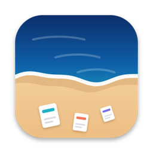
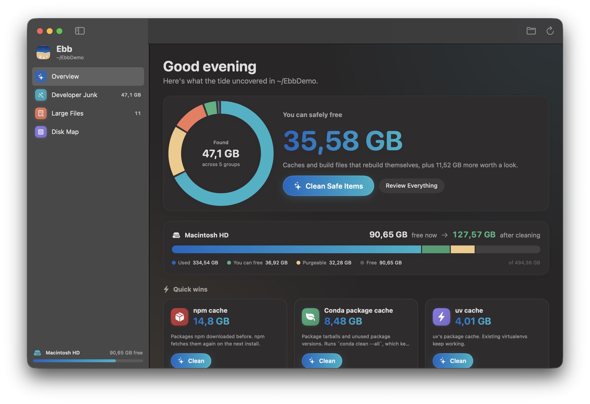
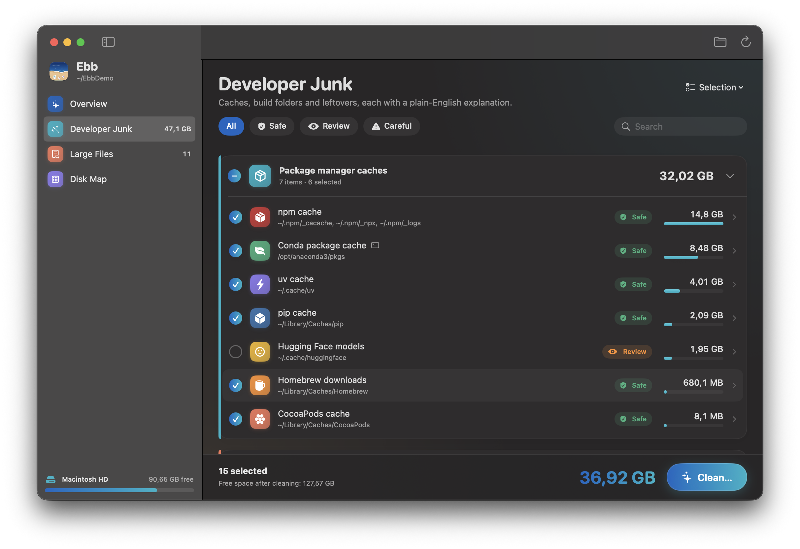
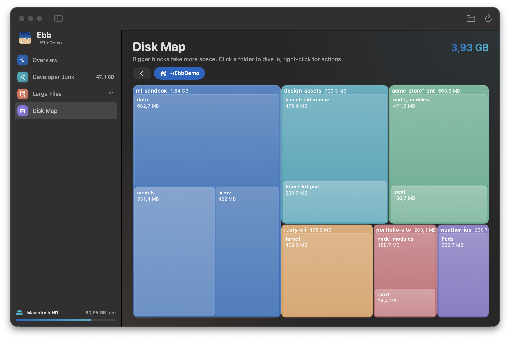
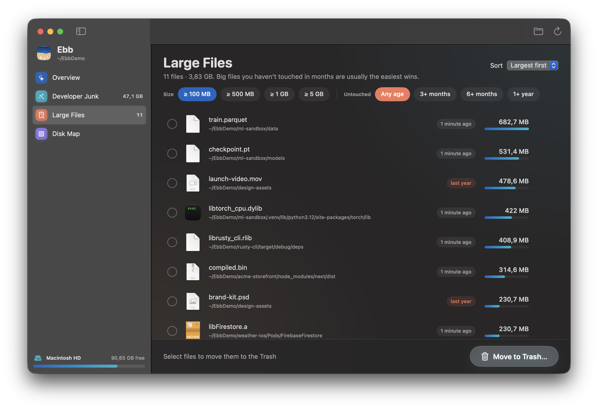
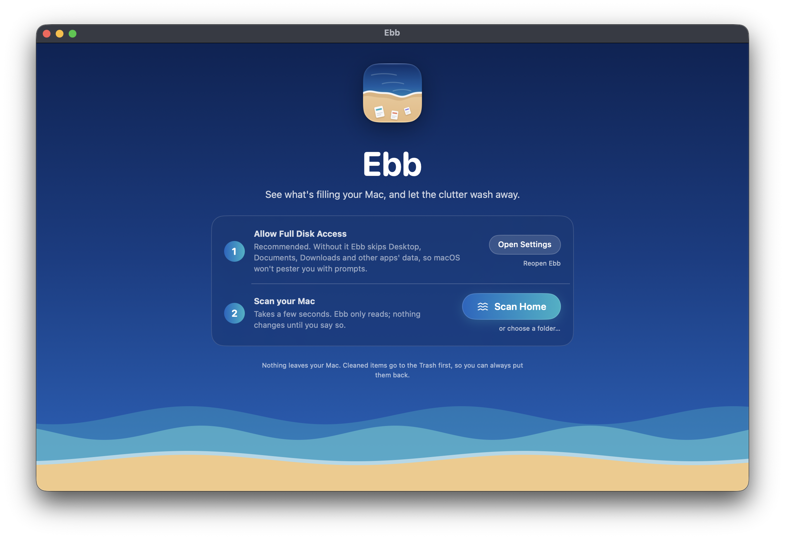
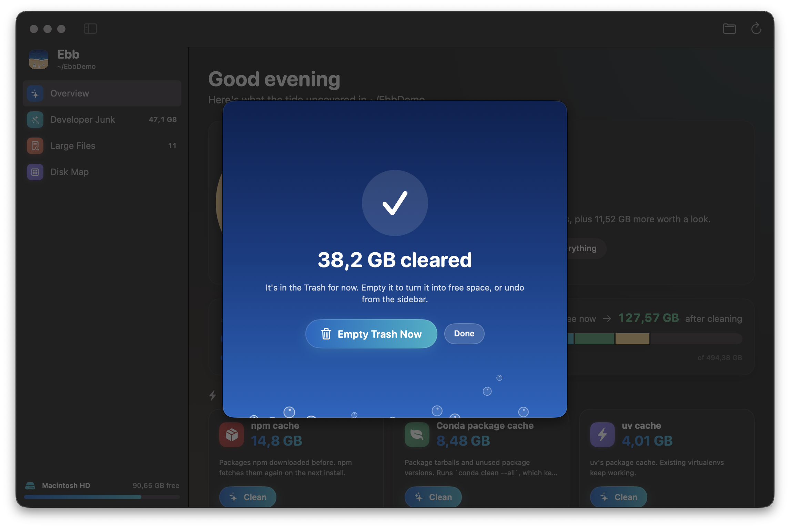

<p align="center">
  
</p>

<h1 align="center">Ebb</h1>

<p align="center">
  <b>A free, open-source disk cleaner for Mac that understands developer junk.</b><br>
  Find what's filling your disk (npm caches, node_modules, Docker, Xcode, conda, pip and more), see why each item is safe to remove, and clean it to the Trash with one click.
</p>

<p align="center">
  <a href="https://github.com/ZNLong2203/Ebb/releases/latest"></a>
  <a href="https://github.com/ZNLong2203/Ebb/releases"></a>
  
  
  <a href="LICENSE"></a>
</p>

<p align="center">
  <a href="https://github.com/ZNLong2203/Ebb/releases/latest/download/Ebb.dmg"><b>⬇️ Download Ebb.dmg</b></a>
  &nbsp;·&nbsp; <a href="#homebrew">Homebrew</a>
  &nbsp;·&nbsp; <a href="#features">Features</a>
  &nbsp;·&nbsp; <a href="#how-ebb-decides-what-is-safe">Safety</a>
  &nbsp;·&nbsp; <a href="#faq">FAQ</a>
</p>

<p align="center">
  
</p>

## Why Ebb

Developer Macs fill up with things that rebuild themselves. Package caches, `node_modules` in projects you haven't opened in months, Docker images, Xcode DerivedData and simulator leftovers all count. macOS lumps much of it into **"System Data"**.

Ebb's first scan of its author's MacBook found **57 GB** of it. More than **35 GB** was safe to remove: the npm cache alone was 14.8 GB, conda 8.5 GB and uv 4 GB.

Ebb is built around the things people dislike about "cleaner" apps:

- **No subscription.** No upsell, no account.
- **No scare tactics.** Every item explains what it is and what happens if you remove it.
- **Nothing is deleted outright.** Cleaned items go to the Trash and can be put back with Undo.
- **Developer-aware.** Where a tool has its own cleanup command, Ebb uses it: `conda clean`, `docker system prune`, `pnpm store prune`, `go clean -modcache`, `xcrun simctl delete unavailable`. It doesn't guess at individual files.

## Features

### 🧹 Developer Junk, explained
Ebb groups everything it finds. Each item has a clear label, its size, and a one-line explanation you can expand.

| Group | What Ebb looks for |
|---|---|
| Package manager caches | npm, Yarn, pnpm, Bun, pip, uv, conda, Homebrew, Gradle, Cargo, CocoaPods, Go modules, Hugging Face models |
| Project build folders | `node_modules`, `.next`, Python virtualenvs, Rust `target`, SwiftPM `.build`, CocoaPods `Pods`, Gradle `.gradle`, all detected by their manifest files |
| Code editors | Cursor, VS Code, Windsurf, VSCodium and JetBrains caches. Settings and extensions are never touched |
| Xcode & simulators | DerivedData, simulator caches, device support files, archives, unavailable simulators |
| Docker | Unused containers, images, networks and build cache, through Docker's own command |
| App caches, logs & backups | Per-app caches, logs and crash reports, old iPhone backups, the Trash |

<p align="center"></p>

### 🗺️ Disk Map
A treemap of the scanned folder, in which bigger blocks take more space. Click a folder to dive in, or right-click to show it in Finder or move it to the Trash.

<p align="center"></p>

### 📦 Large Files
Every file over 100 MB, with Quick Look thumbnails and an "untouched for" badge. You can filter by size and by age. Files inside `~/Library`, which is app data, are locked so you can't delete something an app depends on.

<p align="center"></p>

### 🌊 Thoughtful details
- The disk bar shows how much space you'll have **after** cleaning, before you click anything.
- **Quick wins** let you clear the biggest safe items in one click.
- A short explainer covers what "System Data" really is: local Time Machine snapshots and purgeable space.
- A cleanup summary keeps the one remaining step in front of you, which is emptying the Trash.

<p align="center">
  
  
</p>

## How Ebb decides what is safe

Every item gets one of three labels:

| Label | Meaning | Pre-selected? |
|---|---|---|
| ✅ **Safe** | Rebuilds itself automatically, so nothing is lost (package caches, editor caches, DerivedData, logs) | Yes |
| 👀 **Review** | Can be rebuilt, but costs time or bandwidth: `node_modules`, downloaded AI models, app caches | Only project folders untouched for 30+ days |
| ⚠️ **Careful** | May hold data you care about, like Docker volumes or iPhone backups | Never |

Ebb also follows a few rules for every item:
- Project folders you worked on in the last 7 days are never pre-selected.
- Build folders are only recognised inside ordinary projects. A `node_modules` inside `~/Library`, `~/.nvm` or `~/.vscode` belongs to an installed tool and is left alone.
- Ebb removes whole folders or calls the tool's own command. It never deletes files one by one based on their dates.

## Install

### Download
1. Download **[Ebb.dmg](https://github.com/ZNLong2203/Ebb/releases/latest/download/Ebb.dmg)** and drag **Ebb** into **Applications**.
2. Open Ebb. macOS will say it can't verify the developer, because Ebb isn't notarized yet. Go to **System Settings → Privacy & Security**, scroll down and click **Open Anyway**. You only do this once.

   Or run this in Terminal instead:
   ```bash
   xattr -dr com.apple.quarantine /Applications/Ebb.app
   ```

### Homebrew
```bash
brew tap znlong2203/ebb https://github.com/ZNLong2203/Ebb
brew install --cask znlong2203/ebb/ebb
```
Homebrew handles the Gatekeeper step for you. To update, run `brew upgrade --cask ebb`.

### Full Disk Access (recommended)
Without Full Disk Access, macOS shows a permission dialog for each protected folder: Desktop, Documents, Downloads and other apps' data. Ebb skips those folders instead of interrupting you, and tells you what it skipped.

To include them, turn on Ebb in **System Settings → Privacy & Security → Full Disk Access** and reopen Ebb. The welcome screen has buttons for both steps.

**Requirements:** macOS 14 Sonoma or later on Apple Silicon.

## Performance

Ebb walks the disk with `fts(3)` across all CPU cores.

| | Ebb | `du -sh ~` |
|---|---|---|
| Home folder, 1.23 M files / 218 GB | **5.1 s** | 33.1 s |
| Size reported | 217.84 GB | 217.82 GB |
| Memory during scan | ~50 MB | — |

Sizes are allocated bytes on disk, so sparse files such as `Docker.raw` aren't overstated, and hard links are counted once. Animations run on Core Animation, so the app sits at ~0% CPU when idle.

<sub>Measured on a 14" MacBook Pro running macOS 27.</sub>

## FAQ

**Is it safe?**
Everything goes to the Trash, and **Undo All** in the sidebar puts it back. Only two kinds of action can't be undone. One is running a tool's own cleanup command, and the cleanup screen says so before you confirm. The other is emptying the Trash.

**Why does macOS warn me when I open it?**
Apple only skips that warning for apps notarized under the paid Apple Developer Program. Ebb is open source and ad-hoc signed, so you can read every line or build it yourself. The Homebrew install removes the warning for you.

**Why isn't it on the Mac App Store?**
App Store apps are sandboxed and can't scan your whole disk, which is the whole point of Ebb.

**Does it collect any data?**
No. Ebb makes no network requests and has no analytics. Nothing leaves your Mac.

**How is it different from Mole, DaisyDisk or CleanMyMac?**
- [Mole](https://github.com/tw93/Mole) is a great command-line cleaner. Ebb is a native app for people who'd rather see a map and read an explanation before deleting anything.
- DaisyDisk is beautiful but paid, and it doesn't know what `node_modules` or a conda cache is.
- CleanMyMac is a subscription.
- Ebb is free, open source, Trash-first and developer-aware.

## Build from source

You need the Xcode Command Line Tools (`xcode-select --install`). Full Xcode isn't required.

```bash
git clone https://github.com/ZNLong2203/Ebb.git && cd Ebb
scripts/build-app.sh --run          # builds build/Ebb.app and launches it
```

```
Sources/Ebb/
  App/     entry point, app state, disk info and permissions
  Scan/    parallel fts scanner, tree model, protected-folder rules
  Clean/   junk catalog (what's safe and why) and the Trash-first cleaner
  Views/   SwiftUI screens, theme, Core Animation waves
scripts/   build-app.sh, package.sh, release.sh, icon generation
```

[RESEARCH.md](RESEARCH.md) covers the market research behind Ebb: competitors, user pain points and design decisions.

A debug build listens for the distributed notification `io.github.znlong2203.ebb.debug`. It accepts these commands:
- `scan:<path>`
- `section:<name>`
- `focus:<path>`
- `clean-prefix:<id>`
- `undo-all`
- `demo-report:<bytes>`

They drive the UI for screenshots and tests. To publish a release, run `scripts/release.sh 0.2.0`.

## Roadmap

- [ ] Duplicate file finder
- [ ] Time Machine local snapshot thinning
- [ ] Menu bar disk monitor, plus a "disk almost full" alert in [Islet](https://github.com/ZNLong2203/Islet)
- [ ] App uninstaller with leftover detection
- [ ] More languages

Ideas and pull requests are welcome. Open an issue first for anything big.

## Also by me

**[Islet](https://github.com/ZNLong2203/Islet)** is a Dynamic Island for your MacBook notch: Now Playing, quick notes, a file shelf and a focus timer.

## License

[MIT](LICENSE) © ZNLong2203. Ebb is not affiliated with Apple.
